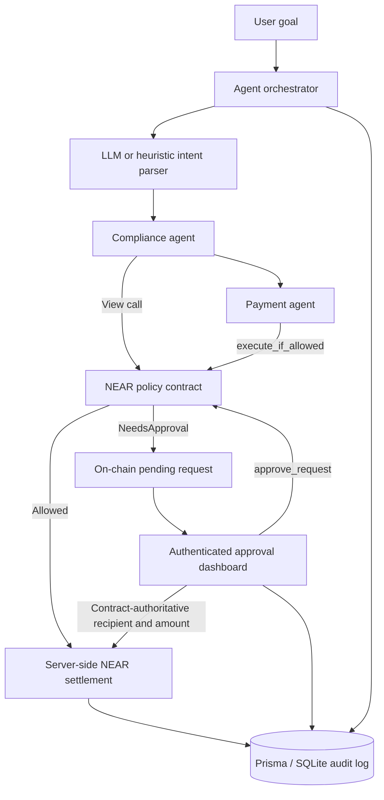

# Autonomous Treasury Mesh

> A policy-enforced treasury orchestration system for autonomous AI agents, built on NEAR Protocol.

[](https://testnet.nearblocks.io/address/treasury-mesh-hack3rwin.testnet)


**NEAR Hackathon 2026** · Submission deadline: November 14, 2026 at 23:59 UTC

**Live policy contract:** [`treasury-mesh-hack3rwin.testnet`](https://testnet.nearblocks.io/address/treasury-mesh-hack3rwin.testnet)

Autonomous Treasury Mesh allows AI agents to request and execute operational payments while keeping spending authority outside the language model. Every payment is evaluated by a NEAR smart contract against human-defined policy. Requests outside policy limits are placed into an on-chain approval queue for an authenticated operator to review.

## Why this project

AI agents can select vendors, negotiate services, and initiate work—but they should not have unrestricted access to treasury keys or be trusted to enforce their own budgets.

This project separates intent from authority:

- The **LLM extracts intent** but never receives the NEAR private key.
- The **NEAR smart contract enforces policy** independently of the model.
- The **backend signs transactions** only after a contract decision or authenticated human approval.
- The **audit layer records decisions and settlement outcomes** for investigation and demo verification.
- A **deterministic heuristic parser** keeps the core flow usable without an external LLM API key.

## Core capabilities

| Capability | Implementation |
| --- | --- |
| Agent payment requests | Natural-language task ingestion through the Next.js API |
| Policy enforcement | Rust smart contract on NEAR Testnet |
| Human-in-the-loop review | On-chain pending requests with approve/reject controls |
| Live settlement | Real NEAR Testnet transfers with transaction hashes |
| Administrative access control | Bearer-token protection for approval and policy mutations |
| Auditability | On-chain events plus an off-chain Prisma/SQLite operational log |
| Zero-key demo mode | Public contract reads and heuristic intent extraction without external AI keys |

## Architecture



### Trust boundaries

1. **Untrusted intent layer** — user prompts and LLM output are treated as untrusted input.
2. **Policy authority** — spending decisions and pending-request state live in the NEAR contract.
3. **Signing boundary** — `NEAR_OWNER_PRIVATE_KEY` remains in the server environment and is never placed in prompts or browser code.
4. **Administrative boundary** — approval and policy write endpoints require `TREASURY_ADMIN_TOKEN`.
5. **Settlement boundary** — an approved transfer uses the recipient and amount retrieved from on-chain pending state, never financial parameters supplied by the browser.

## Security model

The project follows a zero-trust principle: compromise or prompt injection of the LLM must not grant authority to bypass on-chain policy.

### Implemented security controls

| Control | Security property |
| --- | --- |
| On-chain policy evaluation | The model cannot self-authorize spending outside contract rules |
| Contract-authoritative approval settlement | Client-supplied recipient or amount cannot redirect an approved transfer |
| Exact unit conversion with `BigInt` | Prevents floating-point loss and million-fold contract-unit/NEAR conversion errors |
| Owner-only contract mutations | NEAR predecessor checks protect policy and approval state on-chain |
| Admin bearer token | Approval and policy HTTP mutations fail closed when no secure token is configured |
| Positive safe-integer validation | Rejects zero, negative, fractional, non-finite, and unsafe policy values before RPC |
| Bounded NEAR operations | RPC, contract calls, and settlement waits use a configurable timeout |
| Sanitized API errors | Internal NEAR VM and RPC details are not returned to clients |
| Success and failure audit events | Administrative changes, resolution failures, and settlement outcomes are recorded |
| React text rendering | Audit and dashboard fields are rendered as text; no raw HTML sink is used |

### Approval settlement invariant

For approval request `N`, the backend performs the following sequence:

1. Authenticate the administrator request.
2. Load the pending request from the NEAR contract.
3. Locate request `N` in the current on-chain pending set.
4. Approve `N` on-chain.
5. Convert the on-chain contract amount to NEAR using exact integer arithmetic.
6. Transfer only to the on-chain counterparty for the on-chain amount.
7. Record both the approval decision and settlement result.

The approval API accepts only an `action`. Browser-provided `counterparty` and `amount` values are neither required nor trusted.

### Threats addressed

- Prompt injection attempting to bypass financial policy
- Approval recipient or amount tampering
- Unauthenticated approval and policy mutations
- Zero/negative policy values and unsafe numeric coercion
- NEAR RPC calls holding HTTP requests open indefinitely
- Internal blockchain error leakage
- Missing administrative failure records
- Stored-script payloads reaching a raw HTML rendering sink

### Security assumptions and current limitations

This is a hackathon-grade Testnet implementation, not a custody product.

- The server environment and `NEAR_OWNER_PRIVATE_KEY` must be protected by the deployment platform.
- `TREASURY_ADMIN_TOKEN` is a single-operator bearer credential stored in browser `sessionStorage`; production deployments should use an identity provider, short-lived sessions, role-based access control, and hardware-backed signing.
- A timeout bounds the HTTP wait but cannot cancel a transaction already accepted by an upstream NEAR RPC node.
- SQLite audit rows are operational records, not immutable evidence. On-chain events provide the tamper-resistant portion of the audit trail.
- Public task ingestion is intended for the demo. Internet-facing deployments should add authentication, rate limiting, abuse controls, and request quotas to `/api/agent/task`.
- Automatic settlement uses direct NEAR Testnet transfers. NEAR Intents/Defuse integration remains a roadmap item.

## Hackathon tracks

1. **Autonomous Business** — policy-controlled financial operations for autonomous services and digital businesses.
2. **Agent Economy** — coordinated purchasing and settlement across specialized agents.
3. **AI Security & Defense** — financial authority is isolated from the LLM and enforced on-chain.
4. **Privacy & Private AI** — optional compatibility with the NEAR AI Cloud API and confidential-compute model deployments.

## Technology stack

| Layer | Technology |
| --- | --- |
| Dashboard and API | Next.js 16, React 19, TypeScript, Tailwind CSS, shadcn/ui |
| Smart contract | Rust, `near-sdk` 5.6 |
| Blockchain client | `near-api-js` 5.1 |
| Persistence | Prisma 6, SQLite |
| AI providers | NEAR AI Cloud, Anthropic, or deterministic heuristic fallback |
| Settlement | NEAR Testnet native transfer |

## Quickstart

### Prerequisites

- Node.js 20 or newer
- npm
- Rust toolchain with `wasm32-unknown-unknown` for contract development
- A NEAR Testnet account and private key only if write operations are required

### 1. Install and initialize

```bash
# From the repository root
cd web

npm install
npx prisma db push
cp .env.example .env.local
```

Generate a strong administrator token:

```bash
node -e "console.log(require('crypto').randomBytes(32).toString('hex'))"
```

Place the generated value in `TREASURY_ADMIN_TOKEN` inside `.env.local`. To enable contract writes and settlement, also provide the owner account and private key.

### 2. Start the dashboard

```bash
npm run dev
```

Open [http://localhost:3000](http://localhost:3000). Public contract reads and the heuristic parser work without an external AI API key. Administrative writes remain disabled until both NEAR signing credentials and a valid admin token are configured.

### 3. Configure administrator access

Open **Settings → Administrator Access** and enter the same value used for `TREASURY_ADMIN_TOKEN`. The browser keeps it only in the current tab session.

## Environment variables

| Variable | Required | Purpose |
| --- | --- | --- |
| `DATABASE_URL` | Yes | Prisma SQLite connection, normally `file:./dev.db` |
| `NEAR_NETWORK_ID` | No | Defaults to `testnet` |
| `NEAR_NODE_URL` | No | Defaults to the public NEAR Testnet RPC endpoint |
| `NEAR_POLICY_CONTRACT_ID` | No | Defaults to the deployed hackathon contract |
| `NEAR_OWNER_ACCOUNT_ID` | For writes | Account that owns the policy contract and signs transfers |
| `NEAR_OWNER_PRIVATE_KEY` | For writes | Server-only signing key; never expose it to the browser |
| `TREASURY_ADMIN_TOKEN` | For admin writes | Minimum 32-character bearer token for approval and policy endpoints |
| `NEAR_RPC_TIMEOUT_MS` | No | Positive integer timeout; defaults to `8000` ms |
| `NEAR_AI_API_KEY` | No | Enables NEAR AI Cloud intent extraction |
| `NEAR_AI_BASE_URL` | No | Defaults to the configured NEAR AI-compatible endpoint |
| `NEAR_AI_MODEL` | No | Model identifier for NEAR AI Cloud |
| `ANTHROPIC_API_KEY` | No | Enables Anthropic intent extraction |
| `ANTHROPIC_MODEL` | No | Anthropic model override |

Never commit `.env.local`, private keys, API keys, or administrator tokens.

## Verifiable demo

### Scenario A — payment within policy

1. Enter `Pay 10 to alice.testnet for API usage` in the chat.
2. The compliance agent performs a dry-run policy check.
3. The payment agent asks the contract to enforce the policy.
4. An allowed decision is settled on NEAR Testnet and recorded with its transaction hash.

### Scenario B — human approval required

1. Enter a payment that exceeds the current per-transaction or daily policy limit.
2. The contract creates an on-chain pending request.
3. The request appears in **Approvals** and the dashboard control panel.
4. An authenticated administrator approves or rejects it.
5. An approval settles only the on-chain recipient and amount.

### Scenario C — audit review

1. Open **Audit Log**.
2. Review agent activity, policy checks, approval outcomes, and settlement status.
3. Use the transaction hash to verify successful settlement on a NEAR Testnet explorer.

## Verification

Run the complete local verification suite from the repository root:

```bash
node scripts/verify.mjs
```

Or from `web/`:

```bash
npm run verify
```

The runner executes:

- 8 Rust smart-contract unit tests
- Rust Clippy with `pedantic` and `nursery` lints
- 18 web security regression tests
- Strict TypeScript-aware ESLint
- Next.js production compilation and type checking

Run only the fast web security tests with:

```bash
cd web
npm test
```

Security regression coverage includes authentication, authoritative approval settlement, exact amount conversion, RPC deadlines, and policy input validation.

## Repository layout

```text
.
├── contracts/
│   └── policy-engine/
│       ├── src/lib.rs                  # NEAR policy contract
│       └── DEPLOYMENT.md               # Contract deployment guide
├── scripts/
│   └── verify.mjs                      # Unified verification runner
├── web/
│   ├── prisma/schema.prisma            # Operational data and audit schema
│   ├── test/                            # Security regression tests
│   └── src/
│       ├── app/                         # Dashboard pages and API routes
│       ├── components/                  # UI and control-panel components
│       └── lib/
│           ├── agents/                  # Compliance and payment agents
│           ├── admin-auth.ts            # Protected administrative boundary
│           ├── approval-workflow.ts     # Authoritative approval settlement
│           ├── near-timeout.ts          # Bounded NEAR operations
│           ├── near.ts                  # NEAR client and settlement layer
│           ├── orchestrator.ts          # Multi-agent coordination
│           └── policy-validation.ts     # Policy input validation
├── Design.md
└── README.md
```

## Engineering notes

- Contract-facing `u128` and `u64` values use NEAR JSON wrapper types and decimal strings across the JavaScript boundary.
- TypeScript enables strict options including `noUncheckedIndexedAccess` and `exactOptionalPropertyTypes`.
- The LLM is replaceable; policy and signing boundaries do not depend on the selected model.
- The deployed contract and native transfers are on Testnet. No Mainnet funds should be used with this project.

## Roadmap

- NEAR Intents/Defuse settlement support
- Short-lived operator sessions with role-based access control
- Hardware-backed or MPC signing
- Production database and append-only audit export
- Rate limiting and authentication for task ingestion
- Multi-operator approval thresholds
